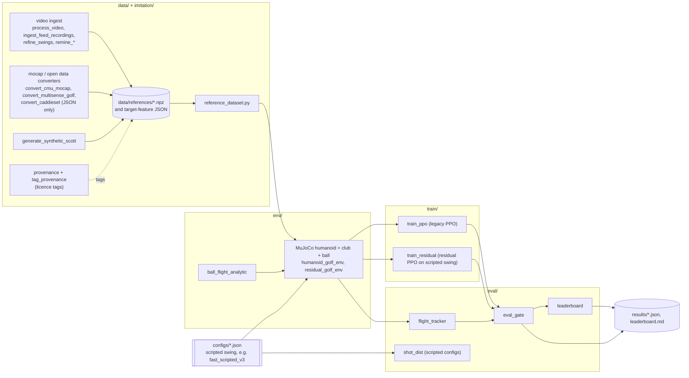

# Humanoid Golf: a MuJoCo humanoid learning to swing a driver

[](requirements.pinned.txt)
[](requirements.pinned.txt)
[](#results)
[](#known-limits)

<!-- HERO SLOT: add a short GIF or thumbnail here (e.g. docs/media/hero.gif), see docs/README.md.
     Do NOT commit raw videos; the smoke test rejects .gif/.mp4/.zip. Host media in a GitHub Release
     or the repo's social-preview upload instead, and link it. No hero media exists yet. -->

> **Research prototype, simulation only.** A MuJoCo humanoid, a driver and a ball, plus the data and evaluation tooling around them. **No trained model currently passes the project's evaluation gate.** The one configuration that passes it is a hand-tuned scripted swing, not a learned policy. No real-robot or real-ball validation exists. Read [Results](#results) before quoting any number.

## What it does

- **Simulates** a humanoid (MJCF in `env/models/`) swinging a driver at a ball in MuJoCo, with a flight tracker that records contact, carry, launch, lateral dispersion and club-head speed (`env/`, `eval/flight_tracker.py`).
- **Trains** PPO policies (stable-baselines3), including a *residual* policy that adds learned corrections on top of a scripted swing (`train/`).
- **Evaluates** with a fixed gate and a leaderboard (`eval/eval_gate.py`, `eval/leaderboard.py`): carry > 11.98 m, lateral std < 2.73 m, contact >= 99%.
- **Builds reference swings** from video and mocap into small `.npz` files with per-file licence tags (`data/`, `imitation/`).
- **Documents what is not known**: strike-regime artefacts, unverified smash factor, data-licence open items.

## The story: one amateur's swing, honestly

The style references come mainly from **one amateur golfer's own swings (Mason, left-handed)**, extracted from phone screen-recordings of Instagram playback (about 30 unique fps, single camera view, 2D-proxy joint angles; see [`docs/MASON_SWINGS.md`](docs/MASON_SWINGS.md) and [`docs/MASON_TARGET_FEATURES.md`](docs/MASON_TARGET_FEATURES.md)). That data has **no club, ball, launch or force measurements**, so it can shape *style* (tempo band, joint ranges) but cannot give a speed or distance target. Residual-PPO runs use one such reference (`--style_ref data/references/mason_swing_part1_s05_refined_mirrored.npz`). Supplementary references: CMU mocap (acknowledgement required), MultiSenseGolf (CC0, right-handed), and synthetic caricatures. The "Scott/Scheffler/Rory" files are **procedurally generated, not real data of those players**. Data-licence status is tracked in [`docs/GOING_PUBLIC_BLOCKERS.md`](docs/GOING_PUBLIC_BLOCKERS.md).

## Architecture

Only components that exist in this repository are shown.



## Results

All numbers are copied from committed files in `results/` (50 to 100 episodes; the file named in each row is the source). Full tables, protocols and caveats: [`docs/RESULTS_DETAIL.md`](docs/RESULTS_DETAIL.md).

**Gate:** carry > 11.98 m AND lateral std < 2.73 m AND contact >= 99%. Simulation only.

### Scripted (hand-tuned, NOT learned)

| Config | Mode | Contact | Mean carry | Launch | Lateral std | Peak club speed | Gate | Source |
|---|---|---|---|---|---|---|---|---|
| Stage 6 `configs/fast_scripted_v3.json` | deterministic = stochastic, zero residual, 50 eps | 100% | 113.8 m | 12.2 deg | 1.66 m | 120.3 mph | **pass** | `results/leaderboard.md` |
| Stage 6, same config in v3tiny gate files | zero residual, 100 eps | 100% | 113.0 m | n/a | 2.12 m | 120.3 mph | pass | `results/gate_ppo_v3tiny_s2{1,2,3}.json` |
| Default scripted swing | deterministic, 50 eps | 100% | 57.8 m | n/a | 4.22 m | 107.9 mph | fail | `results/gate_ppo_resid_v3_left_an2_s0.json` |

### Learned (residual PPO, left-handed) - none qualifies

| Model | Mode | Contact | Mean carry | Lateral std | Peak club speed | Gate | Notes |
|---|---|---|---|---|---|---|---|
| `ppo_resid_v3_left_an2_s0` | deterministic | 100% | 114.3 m | 7.42 m | 114.7 mph | **fail** | pre-fix strike regime |
| `ppo_resid_v3_left_an3_s1` | deterministic | 100% | 108.6 m | 6.74 m | 114.6 mph | **fail** | pre-fix strike regime; leaderboard headline averages det + stoch (102.9 m) |
| `ppo_resid_v3_left_fast2_s11` | deterministic | 100% | 15.2 m | 0.017 m | 123.6 mph | passes literally, **not a real drive** | flat-launch exploit, launch about -5.8 deg |
| `ppo_v3tiny_s21` / `s22` / `s23` (Stage 7, on the Stage 6 script) | deterministic gate | 100% | 86.4 / 105.1 / 93.6 m | 6.45 / 5.23 / 4.43 m | n/a | **fail** | recorded negative result: worse than the scripted base (113.0 m, 2.12 m); `results/gate_ppo_v3tiny_s2*.json` |

Sources: `results/gate_ppo_resid_v3_left_*.json`, `results/gate_ppo_v3tiny_s2*.json`, `results/leaderboard.md`.

**Read this before quoting numbers**
- **No trained model qualifies.** Trained policies have not beaten their scripted baseline.
- **Strike-regime caveat.** Older runs were trained where the club struck the ball with its top edge (see `results/TRAINING_NOTES.md` Stage 5). Re-running frozen checkpoints under the fixed regime changes the numbers a lot (`an3_s1` 108.6 m -> 81.1 m carry; [`results/strike_regime_rerun.md`](results/strike_regime_rerun.md)). Those earlier carry/launch numbers are **not** physical drives.
- **Deterministic vs stochastic** are never mixed in a row; the leaderboard headline averages both modes.
- **Smash factor is unverified** (ball model has no spin or compliance).
- **Carry definition changed between runs** (analytic training carry vs MuJoCo physics gate); compare only within one file.
- **Checkpoints are not published**, so the leaderboard cannot be re-run from this repo alone.

## Path to 350 yd (research targets, not a result)

**Nothing here is achieved or learned.** This section summarises [`docs/research_350yd_profile.md`](docs/research_350yd_profile.md) and the targets in [`data/references/power_profile_350yd_targets.json`](data/references/power_profile_350yd_targets.json) (generated by [`scripts/gen_power_profile_350yd.py`](scripts/gen_power_profile_350yd.py)). The doc tags each number F (fetched), S (search snippet only), D (derived by us) or U (unverified).

**Current verified state (simulation):** the Stage 6 *scripted* swing reaches ~120.3 mph club speed and 113.8 m carry (see [Results](#results) and [`docs/RESULTS_DETAIL.md`](docs/RESULTS_DETAIL.md)). It is not learned, and no trained model passes the gate.

| Item | Value | Basis |
|---|---|---|
| Club speed for a "350-class" drive | ~130 mph club, ~190 mph ball, ~13 deg launch, ~2100 rpm, ~351 yd total | **Derived (D)** from our own `env/ball_flight_analytic.py` at smash 1.48 (calibrated to within -2.5% of the TrackMan tour-average carry). Wind, altitude and turf (about +/-20 yd) are not modeled. |
| Gap from the scripted swing | ~10 mph club speed (+8%), about +17% kinetic energy | D (doc section 8) |
| Smash factor limit | ~1.49 for a centre hit | D; matches TrackMan tour averages (F). Smash in our sim is **unverified**. |
| Tour reference | TrackMan PGA Tour driver average: 113 mph club, 167 mph ball | F (TrackMan PDF) |
| Bryson DeChambeau ~128 mph | Vendor video-AI figure, not radar-verified | Low confidence |

**Wrist torque/damping bottleneck (analytic finding, not yet tested in simulation).** The doc's actuator audit of `env/models/humanoid_golf_v3.xml` computes that the wrist (60 N*m, damping 2) has a no-load speed of ~1719 deg/s and ~450 W max power. At 130 mph it would need ~26.5 rad/s, leaving ~7 of 60 N*m. That is a derived calculation, so treat it as a **hypothesis** until a model change is trained and evaluated. Related model-limit findings in the same doc:
- The chest yaw range is +/-45 deg, and there is no pelvis yaw joint, so pelvis-to-thorax sequencing and X-factor are not representable.
- Club length in the model is ~44 in.; the rules maximum is 48 in.

**Hypothetical elite tier (HYPOTHETICAL, extrapolation only).** The doc's target ladder lists 140 mph (~377 yd) and 150 mph (~399 yd) as later stages. These are beyond any verified tour average, are model extrapolations (power ~ v^3), and are not goals the repo has demonstrated or validated.

**Unverified items (marked U or low confidence in the doc/JSON):**
- Mason's self-reported profile (left-handed, 120+ mph, 300+ yd) is **unverified**; his baseline needs a launch monitor.
- Wrist-only uncock speed and ground-reaction torque magnitudes: **unverified**, nothing retrieved.
- Several rule and literature numbers (USGA Local Rule G-10, CT limit, Cheetham, Hume) were seen only in search snippets (S).
- The JSON bands are plausibility ranges, **not measured data**. Fields marked `unverified=true` should not be used as reward targets without confirmation.
- Overspeed training benefits and injury risk: only vendor-affiliated studies exist, and none report injury outcomes.


## Quickstart

```bash
git clone https://github.com/masonwyatt23/humanoid-golf-scott && cd humanoid-golf-scott
python3 -m venv .venv && source .venv/bin/activate
pip install -r requirements.pinned.txt     # exact versions from the training machine (mujoco 3.16.0, torch 2.14.1+cpu, stable-baselines3 2.9.0, gymnasium 1.4.0)
# or: pip install -r requirements.txt       # unpinned

python3 scripts/smoke_test.py               # stdlib only: compiles .py, checks no videos/zips/model files, results JSON parse, README links
pytest tests                                # unit tests (some tests skip when gitignored originals are absent)

# Evaluate the Stage 6 scripted swing (100 episodes from seed 5000; no trained model needed)
python -m eval.shot_dist configs/fast_scripted_v3.json 100 5000

# Train a residual-PPO policy (exact flags per run: results/TRAINING_NOTES.md)
python -m train.train_residual --timesteps 150000 --flight_model --n_envs 6 --seq_weight 1.0 \
  --name ppo_resid_v3_left_an3_s1 --seed 1 --loft 8 --analytic_ball --elev_target 12.5 --handedness left \
  --style_ref data/references/mason_swing_part1_s05_refined_mirrored.npz --style_weight 1.0

python -m eval.eval_gate <model_name> 50 4000   # gate for a locally trained model
python -m eval.leaderboard                       # needs trained models/*.zip locally (not in git)
```

Training and the leaderboard need locally trained `models/*.zip`; none are distributed. Pinned requirements were captured as a full `pip freeze` and are verified only on the training machine.

## Repository layout

| Path | Contents |
|---|---|
| `env/` | MuJoCo models and environments, analytic ball flight |
| `train/` | PPO and residual-PPO training |
| `eval/` | gate, leaderboard, flight tracker, scripted-config evaluation, renderers |
| `data/`, `imitation/` | reference-swing builders, licence tags, dataset loader |
| `configs/` | scripted-swing configs (e.g. `fast_scripted_v3.json`) |
| `results/` | recorded outputs and [`TRAINING_NOTES.md`](results/TRAINING_NOTES.md) |
| `docs/` | research notes and plans, see [`docs/README.md`](docs/README.md) |
| `tests/`, `scripts/` | tests, smoke test, generators |

## Roadmap

Full list: [ROADMAP.md](ROADMAP.md). Highest-value next steps (none done unless stated):

1. A trained policy that beats the Stage 6 scripted swing on the gate (Stage 7 residual PPO did not).
2. Retrain under the fixed strike regime with longer curriculum training.
3. Unitree G1 model (a G1 env stub exists in `env/g1_golf_env.py`; not evaluated here).
4. WHAM / GVHMR reconstruction to replace MediaPipe 2D proxies ([`docs/WHAM_GVHMR.md`](docs/WHAM_GVHMR.md), documented, not implemented).
5. Ball spin and face/path metrics so results can be compared with launch-monitor data.
6. Actuator and model changes needed for higher club speed (see next section).


## Known limits

- Simulation only; no real-robot or real-ball validation.
- Mason's reference data are 2D proxies from ~30 fps, single-view screen recordings; tempo is a loose band (about 2.5 to 3.5), and no speed target is derivable.
- Stage 6 gate evidence comes from the leaderboard and gate files' `scripted_zero_residual` blocks; there is no standalone gate JSON for it.
- Details: [`docs/RESULTS_DETAIL.md`](docs/RESULTS_DETAIL.md), [`docs/DATA_PIPELINE.md`](docs/DATA_PIPELINE.md).

## Licensing and going public

**This repository has no LICENSE file yet.** Until one is chosen, all rights are reserved by default. Draft options live on the `drafts/license-modelcard` branch (`LICENSE.draft`, `MODEL_CARD.draft.md`) and are drafts only. Third-party data keeps its own terms (GolfDB non-commercial, CMU acknowledgement, CaddieSet unvetted). See [`docs/GOING_PUBLIC_BLOCKERS.md`](docs/GOING_PUBLIC_BLOCKERS.md).

## Contributing, citing

See [CONTRIBUTING.md](CONTRIBUTING.md) and [CITATION.cff](CITATION.cff) (no DOI yet).
